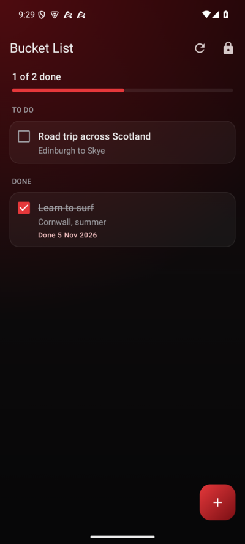

# Bucket List

**A shared bucket list for two people, end-to-end encrypted. Both phones sign in with the same passkey and see the same list; the server only ever stores ciphertext.**

---

## Overview

Bucket List is a native Android app (Kotlin + Jetpack Compose) with a small
self-hosted Go server. You and your partner install the app, sign in with the
same passkey, and keep one list together: add things you want to do, tick
them off when you have done them, and see how far through the list you are.

Each item has a title, optional notes, the date it was added and the date it
was done. Fingerprint unlock is offered after the first sign-in, and the app
locks itself 30 seconds after it leaves the screen.

---

## Download

Get `BucketList-1.0.0.apk` from the [latest release](../../releases/latest).
It asks for your server address the first time it opens.

---

## How it is encrypted

- Passkey -> Argon2id (salt and cost stored on the server) -> `masterKey` and `authKey`.
- The server only stores `SHA-256(authKey)`. `masterKey` never leaves the phone.
- A random `listKey` is made on the phone at setup and stored on the server wrapped with `masterKey`.
- Every item (title, notes, dates) is sealed with `listKey` using AES-256-GCM. The server sees ids and ciphertext only.
- Fingerprint unlock keeps `listKey` in the Android Keystore behind a strong biometric. The passkey always works too.

There is no way to recover a forgotten passkey. Nobody, including the server, can reset it.

---

## Server

One account, made once with a setup token. Logins are rate limited with an
exponential lockout after repeated failures.

| Method | Path | Purpose |
|---|---|---|
| GET | `/v1/kdf` | KDF parameters (public) |
| POST | `/v1/account` | One-time setup, needs `X-Setup-Token` |
| POST | `/v1/login` | `{authKey}` -> `{token, wrappedListKey}` |
| POST | `/v1/logout` | End the session |
| GET | `/v1/files` | List items (sealed) |
| POST | `/v1/files` | Add an item |
| PUT | `/v1/files/{id}/meta` | Change an item |
| DELETE | `/v1/files/{id}` | Remove an item |

Run it locally:

    cd server
    BUCKET_DATA=./data BUCKET_SETUP_TOKEN=<random> go run .
    go test -race ./...

Deploy with Docker. Put `BUCKET_SETUP_TOKEN=<random>` in `.env`, then:

    docker compose up -d --build

It listens on `127.0.0.1:8093`. Publish it with HTTPS through a reverse proxy
or tunnel. The data folder (`BUCKET_DATA_DIR`, default `./data`) is all
ciphertext, so copying it is a full backup or move.

---

## First run

1. Open the app and enter your server address.
2. Turn on **First-time setup**, choose a passkey of at least 8 characters,
   and enter the setup token from the server's `.env`.
3. On the second phone, enter the same server address and passkey. No setup
   token needed.

---

## Building

    cd server && go build -o bucketlist-server . && cd ..
    cd android
    ./gradlew :core:test                      # crypto and end-to-end tests against the real server
    ./gradlew :app:testPublicDebugUnitTest    # app wording tests
    ./gradlew :app:assemblePublicRelease      # app.bucketlist.public

Two editions (the `edition` flavour in `app/build.gradle.kts`):

- `public`: asks for the server address on first open. Switching server
  signs the phone out of the old list.
- `personal`: the server address is built in, read at build time from
  `~/.bucketlist-server-url` (one line, for example
  `https://bucket.example.com`). Without that file it behaves like `public`.

Release builds are signed with `~/.bucketlist-release.jks` (password in
`~/.bucketlist-release.pass`) when those files exist. The `qa` build type is
the release build with local HTTP allowed, for testing against a server on
`127.0.0.1:18080`.

---

## Known limits

- Online only: the list needs the server to open or change.
- If both phones edit the same item at the same moment, the last save wins.

---

## License

[MIT](LICENSE)
